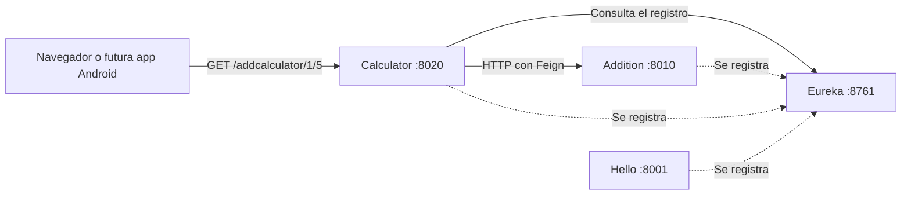

# Microservicios básicos — Clase 12

Ejemplo de estudio en Java basado en los cuatro repositorios de la clase: Eureka Server, Hello, Addition y Calculator. Cada servicio corre como una aplicación independiente. Calculator realiza una llamada HTTP a Addition usando OpenFeign y encuentra su dirección mediante Eureka.

## Abrir y ejecutar en Windows

Necesitas **JDK 17** e internet la primera vez para descargar Maven y las dependencias. No necesitas instalar Maven por separado.

Abre una terminal dentro de esta carpeta, donde están `pom.xml` e `iniciar.cmd`:

```powershell
java -version
.\iniciar.cmd
```

Espera el mensaje `LISTO`. La primera ejecución puede tardar varios minutos por las descargas. Los servicios se ejecutan en segundo plano y escriben sus mensajes en `.run/`.

| Aplicación | Puerto | Abrir en el navegador |
|---|---:|---|
| Eureka: directorio de servicios | 8761 | http://localhost:8761 |
| Hello: saludo | 8001 | http://localhost:8001/greeting |
| Addition: suma | 8010 | http://localhost:8010/addition/1/5 |
| Calculator: pide la suma a Addition | 8020 | http://localhost:8020/addcalculator/1/5 |

Calculator debe mostrar: `Calculator : (1 + 5) = 6`.

```powershell
.\probar.cmd
.\detener.cmd
```

`probar.cmd` comprueba salud, registro, operaciones y una entrada inválida. `detener.cmd` detiene únicamente los procesos que inició este proyecto. Cerrar la terminal no detiene los servicios.

## Cómo se relacionan



Eureka mantiene el directorio; la petición de suma viaja directamente entre Calculator y Addition. Hello es un ejemplo adicional independiente.

## Versiones fijadas

| Herramienta | Versión |
|---|---|
| Java para compilar y ejecutar | 17 |
| Spring Boot | 4.0.9 |
| Spring Cloud | 2025.1.4 |
| Maven Wrapper | 3.3.4 |
| Maven descargado por el wrapper | 3.9.11, con SHA-256 |

Los repositorios de clase consultados declaran Boot 4.1.2 y Cloud 2025.1.4. Aquí se ajustó Boot a 4.0.x, la familia compatible con Cloud 2025.1 según la [tabla oficial de Spring](https://github.com/spring-cloud/spring-cloud-release/wiki/Supported-Versions). No se desactivó la verificación de compatibilidad.

Se añadió LoadBalancer explícitamente para descubrir Addition con Feign, se fijó la URL local del registro, y los fallos del proveedor devuelven HTTP 503. Se mantuvieron los puertos y rutas del material de clase. El `spring-boot-starter-webmvc` corresponde a Spring Boot 4.

## Estudiar o abrir en un IDE

- **Guía desde cero:** [docs/GUIA_DESDE_CERO.md](docs/GUIA_DESDE_CERO.md).
- **Guía y código consultables sin internet:** [docs/GUIA_OFFLINE.html](docs/GUIA_OFFLINE.html). Ábrelo con doble clic.
- **Referencia de archivos:** [docs/REFERENCIA_CODIGO.md](docs/REFERENCIA_CODIGO.md).
- **Peticiones HTTP:** [peticiones.http](peticiones.http), para IntelliJ o un cliente REST.
- **Contexto para resolver compilación en otra PC:** [CONTEXTO_COMPILACION.md](CONTEXTO_COMPILACION.md).

En IntelliJ IDEA abre **la carpeta completa o el `pom.xml` raíz**, impórtalo como Maven y selecciona JDK 17. No abras solamente un módulo. También puedes ejecutarlo desde terminal sin IDE.

Este proyecto es un backend de práctica. La aplicación Android de Lab6 y su Firebase continúan siendo proyectos separados. Android 14 indica la versión del dispositivo; aquí la configuración de compilación depende de Java, Maven, Boot y Cloud.

## Compilar sin iniciar

```powershell
.\mvnw.cmd -B -ntp verify
```

El resultado correcto termina en `BUILD SUCCESS`. Se incluyen cinco pruebas unitarias; la comprobación HTTP requiere los cuatro procesos encendidos. Después de compilar, `iniciar.cmd -SinCompilar` permite arrancar sin repetir la compilación.

## Referencias del curso

- [Clase12_EurekaServer](https://github.com/2026-2-1TEL05-AppsIot/Clase12_EurekaServer)
- [Clase12_EurekaClient_Hello](https://github.com/2026-2-1TEL05-AppsIot/Clase12_EurekaClient_Hello)
- [Clase12_EurekaClient_Addition](https://github.com/2026-2-1TEL05-AppsIot/Clase12_EurekaClient_Addition)
- [Clase12_EurekaClient_Calculator](https://github.com/2026-2-1TEL05-AppsIot/Clase12_EurekaClient_Calculator)
- PDF proporcionado: «Clase 12 - Introducción a los microservicios_25años».
- [Documentación oficial de OpenFeign](https://docs.spring.io/spring-cloud-openfeign/reference/spring-cloud-openfeign.html).

Los scripts `mvnw` y `mvnw.cmd` son Apache Maven Wrapper y conservan sus avisos de licencia Apache 2.0. El código del ejemplo se redactó para estudiar las mismas ideas de clase.
